<h1 align="center">Anderton</h1>

<p align="center"><b>One Claude Code session that runs all the others.</b></p>

<p align="center">
It starts real worker sessions, keeps track of every one, reviews what they build,<br>
and is the one session that deploys.
</p>

<p align="center">
  <a href="https://github.com/davekim917/anderton/actions/workflows/ci.yml"></a>
  
  
  <a href="LICENSE"></a>
</p>

<picture>
  <source media="(prefers-color-scheme: dark)" srcset="assets/flow-dark.svg">
  
</picture>

## Why

Claude Code handles one task per session well. Run several on one repo and the coordination falls
to you: which session is sitting on a permission prompt, which one already opened its PR, which one
is about to deploy something nobody reviewed.

Anderton hands that job to one of your own sessions. It's a plugin for the Claude Code you already
run, so the session in charge works in your repo with your memory, hooks and plugins, and you don't
set up a separate supervisor. Type `/anderton` and that session takes over.

## What it does

- **Starts real sessions, not sub-agents.** Each task gets a full Claude Code session in its own git
  worktree, started from `origin/HEAD`. It loads your user settings and the repo's committed config
  (CLAUDE.md, skills, hooks, plugins) and shares the repo's auto memory. Inside
  [herdr](https://herdr.dev) or tmux it opens in a tab you can watch and type into; elsewhere it
  runs in the background.
- **Has workers report to it.** Each brief tells the worker to message the Anderton by name with
  questions, blockers and the finished PR, and not to deploy. You don't have to check each worker's
  tab for questions.
- **Shows you what's waiting on you.** Before every status report it lists the sessions in the repo
  that have stopped for a person: a finished reply, a permission prompt, a multiple-choice question,
  a tool call stuck for over a minute, a blocked background session. Its own workers report to it
  instead, unless one is stuck on a prompt and can't.
- **Reviews before anything deploys.** Each change gets three questions: is it the right thing to
  build, is it built right ([the engineering bar](skills/anderton/references/good-code.md)), and,
  for data work, are the numbers right. It treats passing tests and a bot review as evidence to
  weigh, not as the decision. Work that falls short goes back to the session that wrote it, with the file, the defect
  and the check that proves the fix.
- **Owns deploys.** Workers stop at a PR, or a merge if your repo lets them merge, and report. The
  Anderton deploys using your repo's own steps, and asks you before any restart. If a merge to your
  main branch deploys on its own, protect the branch or tell the Anderton that workers must not
  merge; otherwise a worker's merge is a deploy.
- **Turns repeat mistakes into checks.** When the same mistake happens twice, the fix becomes a
  check rather than another instruction. It prefers, in order: a design that can't express the
  mistake, a type, a CI rule, a test, and a written rule only as a last resort. Each new check must fail on the
  original mistake.
- **Cleans up.** Retiring a worker stops its session, closes its tab and removes its worktree. A
  worktree with uncommitted or unpushed work is kept; gitignored files are not.

The scripts enforce one Anderton per repo and do the starting, listing and cleanup. Reviewing,
routing and deploying are instructions the Anderton follows, not a sandbox.

## Quick start

Install the plugin:

```
/plugin marketplace add davekim917/anderton
/plugin install anderton@anderton
```

In the session you want in charge, give it a name (workers report to it by name), then start it:

```
/rename anderton
/anderton
```

Then tell it what you want done:

> Add CSV export to the reports page, and find out why the nightly import is slow. Report back
> before changing the import.

It writes a brief for each task and starts a worker for each. From then on the workers ask the
Anderton, not you. It answers what it can, brings you the decisions that are yours, reviews each
PR, and deploys what passes.

**Requirements:** Claude Code with background sessions (`claude --bg`, `claude agents`), built and
tested on 2.1.312; `git`, `jq` and `gh`; optionally herdr or tmux for workers in visible tabs. It
runs on Linux and on macOS, including macOS's stock bash 3.2.

## Questions

**Why full sessions instead of sub-agents?**

A sub-agent runs inside the Anderton's own session and hands back a summary. You can't open it or
talk to it. A worker is an ordinary Claude Code session with its own context, in its own tab, so
you can watch it, steer it, and leave it running for hours.

**What does it cost?**

Each worker is a full Claude Code session and uses your plan the same way a session you open
yourself does: three workers cost about what three sessions cost, plus the Anderton itself, which
reads every diff.

**Is it safe to let it run?**

Workers run in the Anderton's permission mode, because a session in a different mode holds
incoming messages until you approve them. If your Anderton runs with permissions bypassed, so do
its workers. The rule against deploying is in every worker's brief, not a sandbox.

**What does "deploy" mean here?**

Whatever your repo says it means. The plugin has no deploy config of its own: the Anderton reads
your CLAUDE.md and docs for the deploy and health-check steps, and goes through your merge gate if
you have one.

**What if the Anderton session ends?**

The workers keep running. Start a new session, give it the same name, and run `/anderton`; it takes
the role once the old session has exited. Then ask the workers where they stand, since a report
sent while no session had that name may not have arrived.

**How do I stop everything?**

Ask the Anderton to retire its workers. From a plain shell, `retire.sh <name>` does the same; it
lives in the plugin's `skills/anderton/scripts/` folder under `~/.claude/plugins/cache/`. Then
`/plugin uninstall anderton@anderton`. Uninstalling leaves `~/.claude/anderton/` (the role and
worker records) and any worktree that was kept for unpushed work; delete those by hand.

**Does it work with Codex or other agents?**

No. The scripts read Claude Code's own session registry and `claude agents`, so it is Claude Code
only.

**How is it different from firstmate?**

[firstmate](https://github.com/kunchenguid/firstmate) inspired it. firstmate is a full agent
distro: it runs from its own directory, supports many harnesses and backends, adds second mates,
and has a watcher process that notices a stalled crewmate by itself. Anderton is a lighter take for
people who live in Claude Code: one skill and five shell scripts inside the setup you already have.
It has no separate process to run: workers report in, Claude Code's idle notices cover the ones that
don't, and a hook wakes the Anderton when a session in the project blocks on a person.

**Can I have more than one?**

One per repository deploys. A named scope gives a second lead its own lock beside it, for example a
session leading a separate stream of work (`claim.sh --scope <name>`). One session holds one role.

<details>
<summary><b>How it works</b></summary>

The skill is [`skills/anderton/SKILL.md`](skills/anderton/SKILL.md); the bar it reviews against is
[`references/good-code.md`](skills/anderton/references/good-code.md). Five scripts do the
mechanical parts.

**What a project is.** The session's repository, named by its main checkout (or, for a bare
repository, its git dir), so every worktree of it belongs to one project. Outside a repository, it
is the session's directory.

**`claim.sh`** records the claiming session as the project's holder in
`~/.claude/anderton/<key>.json`. The key is `git hash-object` of the project root, which the
record also holds. It exits 3 while another live session holds that project; `--take-over`
replaces it. `--scope <name>` claims a named scope within the project instead, with its own holder
and a key hashed from the root and the name. One session holds one role per project: a session
holding the project or another scope is refused (exit 3), `--take-over` included. The role belongs
to a Claude Code process (its pid plus its registry start time), not a session id, so it survives
`/clear`.

**`waiting.sh`** lists the live sessions in the caller's project (`--all`: every project) that wait
on a person, leaving out every holder in the caller's project, the project's and each scope's:

- the turn ended with Claude's text;
- the registry's `status` says the session is blocked on a permission prompt or an
  `AskUserQuestion`, in the main thread or a sub-agent;
- without that status, a tool call has gone unanswered for over a minute (`PERMISSION PROMPT?`,
  with the tool and the first 200 characters of its input).

It reads `~/.claude/sessions/*.json`, keeps sessions whose process is alive and started when the
registry says, and finds each transcript under `~/.claude/projects/*/<session id>.jsonl`.
Background sessions have no registry entry, so it also reads `claude agents --json`. It lists one
that is `blocked`, and one that is `done` with a turn in the last two days. A worker `spawn.sh`
started is listed, marked `(worker)`, only while the registry or `claude agents` says it is
blocked on a prompt; otherwise it reports to the Anderton.

**`spawn.sh --effort LEVEL [--bg] [--model M] [--mode MODE] [--base REF] <name> [brief-file]`**
starts a worker: a full Claude Code session named `<name>`, in a new git worktree at
`$ANDERTON_WORKTREES/wt-<name>` (default: the folder that holds the repository). The base is
`origin/HEAD`, else `origin/main`, `origin/master` or `HEAD`.

- Inside herdr (`HERDR_ENV=1`), the worker opens in a new tab of the caller's workspace, labelled
  `<name>` (`herdr tab create`, `herdr agent start --kind claude`, then `herdr agent prompt` with
  the brief). If Claude Code stops at a startup prompt there, the spawn shows the screen, closes the
  tab and fails, unless the session cannot be confirmed stopped, when it keeps the worktree and
  record for `retire.sh`.
- Inside tmux (`$TMUX`, and not herdr), it opens in a new detached window named `<name>`. The spawn
  waits up to `$ANDERTON_START_WAIT` seconds (default 30) for the session to register: a window
  that closes first fails the spawn, and one still open is kept with a note that it may wait at a
  startup prompt.
- Elsewhere, or with `--bg`, it is a background session (`claude --bg`).
- It runs in the caller's permission mode, read from the caller's transcript.
- `--effort` is required (`low`, `medium`, `high`, `xhigh` or `max`), so a worker never runs at the
  default just because nobody chose. The Anderton picks it from your request and says so; a level you
  name wins.
- The brief, from the file or stdin, gets a closing rule: report to the caller by name with
  SendMessage, and don't deploy, restart or message anyone off the machine unless the task says to.
- The worker is recorded in `~/.claude/anderton/workers/<name>.json`, with the herdr or tmux server
  it was opened in.

**`retire.sh <name>`** stops that worker, then removes its worktree and record. A herdr tab or tmux
window is closed only when it still carries the worker's name in the server recorded at spawn, and
the worker counts as stopped only when that tab or window is gone and its name has left
`claude agents`; a background worker is stopped with `claude stop`. It exits 3 and keeps the
worktree when the worktree has uncommitted changes, or commits since it started that no remote
branch has. Gitignored files don't count as changes.

**`watch.sh`** is the plugin's one hook, a background `Stop` hook. It runs in every session and exits
at once, in about 50 ms, in any session that isn't its project's holder. In the holder it keeps
running and checks `waiting.sh --blocked` every 30 seconds, about 0.8 seconds of work on a project of
a dozen sessions. When another session newly blocks on a permission prompt or `AskUserQuestion`,
sub-agents included, it exits 2 and Claude Code's `asyncRewake` wakes the holder with the session's
name, even when the holder is idle. The next `Stop` starts it again. The alert carries none of the
blocked session's text. The hook can't answer a prompt: a background hook can't return a decision.
While a woken holder is mid-turn no watch runs, so a block in that turn is reported when the turn ends.

**`prompt.sh <name> [yes|no <fingerprint>]`** lets you answer a permission prompt from the Anderton
session. It reads the prompt from the session's herdr tab or tmux pane and prints it with a
fingerprint. On your answer it re-reads the screen, refuses unless the prompt is unchanged, presses
Enter (`yes`, this one call) or Esc (`no`), and confirms from the screen that the prompt closed. It
refuses a cursor not on a plain "1. Yes", so it can't pick "always allow". A dialog taller than its
screen has lost its top, and neither herdr nor tmux can bring it back, so for a Bash command it reads
the full text from the session's transcript, and only if that session has one call waiting and the
lines still on screen are where that command ends. A hook that rewrites a command above those lines
wouldn't show. Any other dialog taller than its screen is refused. Only a session holding an Anderton role in the target's project can run it. That your
word triggers it is an instruction to the Anderton, not something the script can prove, and a
session running without permission checks can press keys by other means: this prevents mistakes
and isn't a security boundary. It sees what the terminal draws, so what a terminal doesn't draw, such
as a control character, it can't show you either. Background sessions have no tab, and `AskUserQuestion` isn't covered.

All six honour `CLAUDE_CONFIG_DIR` and need `jq`, `git` and a POSIX `ps`.

**Tests.** `bash test/structure.test.sh` and `bash test/scripts.test.sh`. The second drives the
scripts against a throwaway Claude Code home, with fake `claude`, `herdr` and `tmux` commands and
sessions in several projects. CI runs both on Linux and on macOS's own `/bin/bash`, and runs
shellcheck.

</details>

## Built with it

Anderton runs the development of [Anderton Agent](https://github.com/davekim917/anderton-agent), a
personal fleet of AI agents in Slack and Discord, where it is the one session that deploys.

## Credits

The name is John Anderton, Tom Cruise's character in *Minority Report*: the one at the wall of
screens who sees everything coming in and steps in before it goes wrong. Parts of the skill are
adapted from [pstack](https://github.com/cursor/plugins) by Lauren Tan; see
[NOTICE.md](NOTICE.md). MIT licensed.
